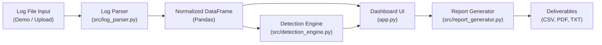

# 🛡️ Security Log Analyser

> A professional Python-based security log analysis dashboard that detects suspicious login patterns, visualises system telemetry, and generates downloadable incident reports.

[](https://www.python.org/)
[](https://streamlit.io/)
[](https://plotly.com/)
[](https://docs.pytest.org/)
[](LICENSE)

---

## 📌 Project Overview

**Security Log Analyser** is a functional, lightweight Security Operations Center (SOC) triage application built for final-year ICT students and junior security analysts. It provides automated ingestion, structured parsing, transparent heuristic detection, interactive visual analytics, and audit reporting for authentication logs.

Rather than relying on black-box heuristics or heavy enterprise SIEM infrastructure, this application demonstrates core software engineering, data analysis, and cybersecurity concepts using modern Python, Streamlit, and Plotly.

---

## 🎯 Problem Statement & Objectives

### Problem Statement
System authentication logs (such as Linux `/var/log/auth.log`) contain vital audit records of access attempts, privilege escalations, and connection drops. However, in raw text format, high-velocity log volumes overwhelm human operators, allowing brute-force attempts and post-compromise logins to slip by unnoticed.

### Objectives
1. **Automated Forensic Ingestion:** Parse unstructured syslog headers and daemon messages into a consistent, strongly typed Pandas DataFrame.
2. **Transparent Rule-Based Detection:** Implement configurable rolling-window heuristics for brute force attacks, credential compromises, event bursts, and persistent failure anomalies.
3. **Actionable Visual Telemetry:** Render interactive Plotly charts and KPI summary cards that respond to real-time filters.
4. **Investigation & Triage:** Provide fast multi-criteria filtering, search, and plain-English threat evidence explanations.
5. **Incident Reporting:** Enable one-click exports of filtered events, alerts, executive summaries, and formal PDF incident reports.

---

## ✨ Features

- **🚀 Instant Demo Mode:** Preloaded with synthetic attack scenarios (brute force, credential compromise, event bursts) so recruiters and evaluators can test the system instantly with zero configuration.
- **📂 Secure Log Upload:** Accepts `.log` and `.txt` files with strict file size limits (10MB), extension validation, and in-memory parsing.
- **🔍 Robust Parsing Engine:**
  - Extracts timestamp, hostname, daemon process, PID, username, source IP, port, event type, and login outcome.
  - Validates IP addresses using Python's standard `ipaddress` module (safely rejecting invalid IPs).
  - Preserves malformed or unrecognised log lines for audit review without falsely classifying them as attacks.
- **⚙️ Configurable Detection Rules:**
  - **Rule 1 (Repeated Failed Logins):** Detects $\ge 5$ failures from the same source IP in a 5-minute rolling window (Brute Force).
  - **Rule 2 (Success After Repeated Failures):** Flags successful logins following $\ge 5$ failures from the same IP within 10 minutes (Credential Compromise).
  - **Rule 3 (Unusual Event Bursts):** Detects $\ge 20$ events from the same IP in 5 minutes (Automated Scanners / DoS).
  - **Rule 4 (Dataset-Wide Persistent Failures):** Identifies IPs with $\ge 8$ cumulative failures across the dataset.
  - Interactive sidebar sliders to adjust thresholds on the fly.
- **📊 Interactive Visualizations:**
  - Event activity timeline histogram colored by login outcome.
  - Alert severity distribution donut chart.
  - Top 10 most frequent source IPs bar chart.
  - Event type breakdown chart.
- **📑 Multi-Format Reporting:**
  - Export filtered log events (CSV).
  - Export security alerts register (CSV).
  - Executive briefing summary (TXT/Markdown).
  - Incident Summary Report (PDF via ReportLab).

---

## 🛠️ Technology Stack

| Component | Technology | Purpose |
|---|---|---|
| **Language** | Python 3.10+ | Core programming and data pipelines |
| **User Interface** | Streamlit | Responsive cybersecurity web dashboard |
| **Data Processing** | Pandas | Log normalisation, aggregation, and filtering |
| **Visualisation** | Plotly | Interactive charts (histograms, donut charts, bar charts) |
| **IP Validation** | `ipaddress` (Standard Library) | Validates IPv4 and IPv6 structures |
| **PDF Generation** | ReportLab | Programmatic generation of incident PDF reports |
| **Testing** | pytest | Automated unit testing and regression test suite |
| **Version Control** | Git & GitHub | Source code tracking and portfolio delivery |

---

## 🏛️ Architecture Overview



For full details on the data pipeline, state management, and threat model, see the [Project Architecture Document](docs/project_architecture.md).

---

## 📁 Project Folder Structure

```text
security-log-analyser/
├── app.py                      # Main Streamlit dashboard application
├── config.py                   # Central configuration & detection thresholds
├── requirements.txt            # Project dependencies
├── pytest.ini                  # Pytest configuration
├── README.md                   # Project documentation & portfolio guide
├── LICENSE                     # MIT License
├── .gitignore                  # Git exclusion rules
├── data/
│   └── sample_auth.log         # Realistic synthetic authentication logs
├── src/
│   ├── __init__.py             # Source package initializer
│   ├── log_parser.py           # Syslog parsing & IP validation engine
│   ├── detection_engine.py     # Rule-based threat detection heuristics
│   └── report_generator.py     # CSV, TXT, and PDF report generation
├── tests/
│   ├── test_log_parser.py      # Tests for parser, timestamps & IP validation
│   ├── test_detection_engine.py# Tests for rules 1-4 & boundary cases
│   └── test_report_generator.py# Tests for CSV, summary, and PDF generation
└── docs/
    ├── project_architecture.md # Architectural design & threat model
    └── screenshots/
        └── README.md           # Screenshot guidance & placeholders
```

---

## 📄 Supported Log Formats

The parser natively supports standard Linux authentication logs:
- **BSD Syslog (RFC 3164):** `Oct 25 10:14:02 srv-01 sshd[1234]: Failed password for invalid user admin from 203.0.113.45 port 39120 ssh2`
- **ISO 8601 Timestamps:** `2026-10-25T10:14:02+00:00 srv-01 sshd[1234]: Accepted password for alice from 192.168.1.50 port 54122 ssh2`
- **Supported Daemon Events:** `sshd` password and publickey logins, session opens/closes, connection disconnects, PAM authentication checks, and `sudo` privilege command executions.

> **Windows Event Logs:** Binary Windows `.evtx` files are not supported natively in this lightweight parser. Users wishing to analyse Windows security events should export them to text/syslog format prior to ingestion.

---

## 🔒 Security & Privacy Considerations

1. **Untrusted Input Handling:** Uploaded logs are processed as untrusted text strings. File contents are never executed or evaluated dynamically.
2. **Local Processing Guarantee:** No log data is transmitted across networks or sent to third-party APIs.
3. **Non-Invasive Analysis:** The application operates strictly in passive analysis mode. It does **not** scan networks, block IP addresses, or interact with external hosts.
4. **Synthetic Data Policy:** All sample logs use RFC 5737 documentation IP ranges (`198.51.100.0/24`, `203.0.113.0/24`) and synthetic test accounts.

---

## 🚀 Installation & Setup (Windows)

### Prerequisites
- Python 3.10 or higher installed. Verify with:
  ```powershell
  python --version
  ```

### 1. Clone or Open the Repository
```powershell
cd "c:\Users\sandi\OneDrive\Desktop\Cyber Security"
```

### 2. Create and Activate Virtual Environment
```powershell
python -m venv .venv
.venv\Scripts\Activate.ps1
```
*(If PowerShell restricts script execution, run: `Set-ExecutionPolicy -Scope Process -ExecutionPolicy Bypass`)*

### 3. Install Dependencies
```powershell
pip install -r requirements.txt
```

### 4. Run Automated Tests
Verify all 35 tests pass:
```powershell
pytest -v
```

### 5. Launch the Application
```powershell
streamlit run app.py
```
The application will launch in your default web browser at `http://localhost:8501`.

---

## 💡 How to Use the Application

### 1. Evaluating in Demo Mode
1. Open the dashboard at `http://localhost:8501`.
2. Ensure **🚀 Demo Mode (Synthetic Logs)** is selected in the sidebar.
3. The dashboard immediately renders pre-calculated telemetry, KPI metric cards, and 4 interactive charts.
4. Scroll to **Detected Security Alerts** to review triggered attack scenarios (including brute force attacks from `203.0.113.45` and post-failure compromise from `198.51.100.22`).
5. Expand the **🔎 View Plain-English Forensic Explanations** section to see why each alert was flagged.

### 2. Uploading Custom Logs
1. In the sidebar, select **📂 Upload Custom Log (.log, .txt)**.
2. Drag and drop your `.log` or `.txt` file (max 10MB).
3. Review the **Parsing Quality** telemetry bar and check any unparsed lines in the preserved audit expander.
4. Adjust detection threshold sliders in the **⚙️ Detection Rule Thresholds** section to match your environment.

### 3. Filtering & Investigation
- Use the **Search Logs & Alerts** box to search for usernames (e.g., `devops`), IP addresses, or commands.
- Use multiselect dropdowns for **Event Type**, **Login Outcome**, and **Alert Severity**.
- Adjust the **Timestamp Range** slider to isolate specific attack windows.

### 4. Exporting Incident Reports
Scroll to the **Incident Reporting & Exports** section at the bottom of the page:
- Click **Export Filtered Events (CSV)** to download the active event view.
- Click **Export Security Alerts (CSV)** for the detected alerts register.
- Click **Export Executive Summary (TXT)** for a plain-text markdown report.
- Click **Export Incident Report (PDF)** to generate a formal incident briefing document.

---

## 🧪 Automated Testing

The project includes a comprehensive automated test suite with **35 unit tests** covering:
- Valid and invalid IP address validation (IPv4 and IPv6).
- BSD syslog and ISO 8601 timestamp parsing.
- Malformed and unrecognized log preservation.
- Rule 1, 2, 3, and 4 threshold boundary conditions.
- Empty datasets, NaT timestamps, and missing fields.
- CSV export formatting and ReportLab PDF binary byte generation.

Run the test suite with:
```powershell
pytest -v
```

Expected output:
```text
tests/test_detection_engine.py::TestRule1RepeatedFailedLogins::test_threshold_triggered PASSED
tests/test_detection_engine.py::TestRule1RepeatedFailedLogins::test_below_threshold_boundary PASSED
tests/test_detection_engine.py::TestRule1RepeatedFailedLogins::test_window_exceeded_no_alert PASSED
tests/test_detection_engine.py::TestRule2SuccessAfterFailures::test_success_after_5_failures_triggers_alert PASSED
tests/test_detection_engine.py::TestRule2SuccessAfterFailures::test_insufficient_failures_before_success PASSED
tests/test_detection_engine.py::TestRule3UnusualEventBursts::test_burst_triggered PASSED
tests/test_detection_engine.py::TestRule3UnusualEventBursts::test_burst_below_threshold PASSED
tests/test_detection_engine.py::TestRule4DatasetRepeatedFailures::test_threshold_triggered PASSED
tests/test_detection_engine.py::TestRule4DatasetRepeatedFailures::test_below_threshold PASSED
tests/test_detection_engine.py::TestEngineEdgeCases::test_empty_dataframe PASSED
tests/test_detection_engine.py::TestEngineEdgeCases::test_missing_ip_and_timestamp_handled_safely PASSED
tests/test_log_parser.py::TestValidateIP::test_valid_ipv4 PASSED
tests/test_log_parser.py::TestValidateIP::test_valid_ipv6 PASSED
tests/test_log_parser.py::TestValidateIP::test_invalid_ip PASSED
tests/test_log_parser.py::TestValidateIP::test_empty_and_none PASSED
tests/test_log_parser.py::TestParseTimestamp::test_bsd_syslog_format PASSED
tests/test_log_parser.py::TestParseTimestamp::test_bsd_syslog_single_digit_day PASSED
tests/test_log_parser.py::TestParseTimestamp::test_iso8601_format PASSED
tests/test_log_parser.py::TestParseTimestamp::test_invalid_timestamp PASSED
tests/test_log_parser.py::TestParseLogLine::test_successful_password_login PASSED
tests/test_log_parser.py::TestParseLogLine::test_failed_password_login PASSED
tests/test_log_parser.py::TestParseLogLine::test_session_disconnect PASSED
tests/test_log_parser.py::TestParseLogLine::test_sudo_execution PASSED
tests/test_log_parser.py::TestParseLogLine::test_invalid_ip_in_log_handled_safely PASSED
tests/test_log_parser.py::TestParseLogLine::test_malformed_unrecognized_line PASSED
tests/test_log_parser.py::TestParseLogLine::test_empty_line PASSED
tests/test_log_parser.py::TestParseLogContent::test_empty_content PASSED
tests/test_log_parser.py::TestParseLogContent::test_mixed_log_batch PASSED
tests/test_report_generator.py::TestCSVExport::test_export_events_csv_contains_headers_and_rows PASSED
tests/test_report_generator.py::TestCSVExport::test_export_events_csv_empty PASSED
tests/test_report_generator.py::TestCSVExport::test_export_alerts_csv PASSED
tests/test_report_generator.py::TestCSVExport::test_export_alerts_csv_empty PASSED
tests/test_report_generator.py::TestExecutiveSummaryText::test_summary_with_alerts PASSED
tests/test_report_generator.py::TestExecutiveSummaryText::test_summary_without_alerts PASSED
tests/test_report_generator.py::TestPDFReport::test_pdf_generation_bytes PASSED

============================= 35 passed in 2.07s ==============================
```

---

## 📷 Screenshots

To capture genuine screenshots for your portfolio:
1. Run the app (`streamlit run app.py`) and select **Demo Mode**.
2. Save screenshots into `docs/screenshots/` (e.g. `dashboard_overview.png`, `alerts_triage.png`).
3. Embed them here:

```markdown

*Figure 1: Incident detection dashboard displaying KPI cards, timeline, and telemetry.*
```

---

## ⚠️ Known Limitations

1. **Log Format Scope:** The parser is tuned for Linux syslog (`auth.log`, `secure`) and systemd authentication formats. Windows Event Viewer `.evtx` binary logs are not natively parsed.
2. **Single-Node In-Memory Processing:** Designed for incident triage and portfolio demonstration. Ingesting multi-gigabyte log dumps is better suited to distributed pipelines (e.g., Elasticsearch, OpenSearch, ClickHouse).
3. **Single Year Context in BSD Syslog:** Standard BSD syslog does not record the calendar year. The parser defaults to the current execution year unless otherwise specified.

---

## 🔮 Future Improvements

- [ ] **GeoIP Enriched Telemetry:** Integrate MaxMind GeoLite2 or IP2Location to display attack origins on an interactive world map.
- [ ] **Windows Event Log Transpiler:** Add parsing for exported Windows Security XML/CSV event logs (Event ID 4624, 4625).
- [ ] **MITRE ATT&CK Mapping:** Annotate alerts with specific technique IDs (e.g., T1110 - Brute Force, T1078 - Valid Accounts).
- [ ] **Persistent Historical Database:** Add optional lightweight SQLite or DuckDB support for archiving past incident analyses.

---

## 🌐 GitHub & Deployment Guide

### Git Repository Setup
To push this project to a new GitHub repository:

```powershell
# 1. Initialize Git repository
git init

# 2. Add files
git add .

# 3. Create initial commit
git commit -m "feat: initial commit of Security Log Analyser portfolio project"

# 4. Set main branch and remote
git branch -M main
git remote add origin https://github.com/MzamoMagudulela/Security-Log--Analyser.git

# 5. Push code
git push -u origin main
```

**Recommended Repository Topics:**
`python`, `cybersecurity`, `streamlit`, `log-analysis`, `data-analytics`, `security-monitoring`

### Deploying to Streamlit Community Cloud
1. Push your repository to GitHub.
2. Log into [share.streamlit.io](https://share.streamlit.io/).
3. Click **New app**, select your repository `security-log-analyser`, set the branch to `main`, and main file path to `app.py`.
4. Click **Deploy**. The app will build automatically using `requirements.txt`.

---

## 📄 License

This project is licensed under the MIT License - see the [LICENSE](LICENSE) file for details.
