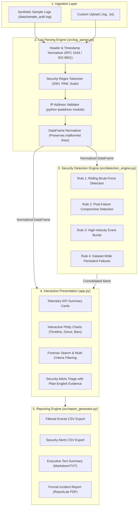

# Security Log Analyser - Project Architecture & Technical Design

This document details the architectural design, component interactions, threat detection methodology, and data pipelines powering the **Security Log Analyser**.

---

## 1. System Overview

The **Security Log Analyser** is structured as a modular, decoupled cybersecurity telemetry and triage platform. Rather than binding data parsing and threat heuristics directly to the presentation layer, the application maintains strict separation of concerns across dedicated modules.

---

## 2. Component Breakdown

### A. Central Configuration (`config.py`)
Acts as the single source of truth for configurable operational limits and heuristic thresholds:
- Detection parameters: window intervals (in seconds), count thresholds, and default severity levels.
- Upload limits: file extensions (`.log`, `.txt`) and maximum size in megabytes (10MB).
- Visual tokens: standardized hex color schemes for threat severities (`High`, `Medium`, `Low`, `Informational`).

### B. Log Parsing Engine (`src/log_parser.py`)
Responsible for transforming unstructured, heterogeneous authentication logs into strongly typed, normalized data:
- **Header Parsing:** Uses regular expressions matching BSD syslog (RFC 3164) and ISO 8601 timestamps, extracting timestamp, host, daemon/process name, and process ID (PID).
- **Security Event Tokenization:** Classifies events into `Login Success`, `Login Failure`, `Logout`, `Session Disconnected`, and `System Event`.
- **IP Validation:** Employs Python's standard `ipaddress.ip_address` module. Malformed or invalid IP strings (e.g., `999.999.999.999`) are safely rejected and marked as `None` rather than triggering unhandled runtime exceptions.
- **Malformed Line Preservation:** Records that fail format validation are not discarded or falsely flagged as malicious attacks; they are preserved with `is_parsed=False` and an explicit `error_reason` so security analysts can inspect parsing fidelity.

### C. Security Detection Engine (`src/detection_engine.py`)
Executes transparent, rule-based cybersecurity heuristics with configurable rolling windows:
- **Rule 1 (Repeated Failed Logins):** Employs sliding time windows per source IP to identify clusters of authentication rejections ($\ge 5$ failures within $300$ seconds). Prevents duplicate spam alerts for continuous attack waves by collapsing consecutive bursts.
- **Rule 2 (Successful Login After Repeated Failures):** Identifies successful authentications preceded by repeated failures from the identical IP address ($\ge 5$ failures within $600$ seconds), flagging probable credential stuffing or dictionary attack breakthroughs.
- **Rule 3 (Unusual Event Bursts):** Detects excessive telemetry velocity from a single entity ($\ge 20$ events within $300$ seconds), capturing automated scanners, aggressive fuzzing, or DoS attempts.
- **Rule 4 (Dataset-Wide Persistent Failures):** Aggregates failed attempts across the entirety of the ingested dataset ($\ge 8$ failures), pinpointing low-and-slow attackers who pace attempts to evade short rolling windows.
- **Plain-English Explanations:** Every alert includes an unambiguous explanation summarizing the exact counts, window durations, targeted accounts, and security implications.

### D. User Interface & Visualization (`app.py`)
Constructed using Streamlit and Plotly:
- **Dual Ingestion Paths:** Seamless toggling between a pre-packaged **Demo Mode** (zero setup for recruiters) and **Custom Upload Mode** (analysing user-supplied logs).
- **Dynamic Threshold Controls:** Interactive sliders allow analysts to fine-tune detection sensitivities in real time.
- **Multi-Dimensional Filters:** Cross-filters by timestamp range, event type, login outcome, source IP, alert severity, and free-text search queries.
- **Interactive Visualizations:**
  1. *Event Activity Timeline:* Time-series histogram colored by authentication outcome.
  2. *Severity Distribution:* Donut chart visualizing alert threat profiles.
  3. *Top Source IPs:* Ranked horizontal bar chart highlighting aggressive origins.
  4. *Event Type Breakdown:* Frequency chart of system and auth event categories.

### E. Report Generation Engine (`src/report_generator.py`)
Generates actionable audit deliverables that strictly reflect the active filter state:
- **CSV Data Exports:** Standalone structured exports for filtered raw events and flagged alerts.
- **Executive Summary:** Plain-text/markdown briefing containing ingestion metrics, telemetry counts, and top threat findings.
- **Incident PDF Report:** Rendered via ReportLab, producing a formatted document complete with metadata tables, severity-styled alert registers, and triage disclaimers.

---

## 3. Threat Modeling & Heuristic Logic

| Rule ID | Rule Name | Default Threshold | Severity | Target Behavior / Indicator |
|---|---|---|---|---|
| **RULE_1** | Repeated Failed Logins | $\ge 5$ fails / 5 min | **High** | Brute-force password guessing, dictionary attacks |
| **RULE_2** | Success After Failures | $\ge 5$ fails prior to success / 10 min | **High** | Credential guessing breakthrough, account compromise |
| **RULE_3** | Unusual Event Bursts | $\ge 20$ events / 5 min | **Medium** | Automated scanner, port/service enumeration, DoS |
| **RULE_4** | High-Frequency Failures | $\ge 8$ fails across dataset | **Medium** | Low-and-slow distributed brute-force, persistent adversary |

---

## 4. Privacy & Safety Controls

1. **Local In-Memory Execution:** Uploaded files are processed strictly in memory or temporary streams. No data is sent to third-party endpoints or cloud APIs.
2. **Untrusted Input Handling:** Uploaded logs are treated as untrusted strings. The parser strictly regularizes text and never executes file contents or eval expressions.
3. **Passive Telemetry Only:** The application operates strictly in analysis and monitoring mode. It does not issue network requests, scan external addresses, or alter host firewall rules.
4. **Credential Isolation:** The codebase contains zero API keys, hardcoded credentials, or production infrastructure artifacts.
